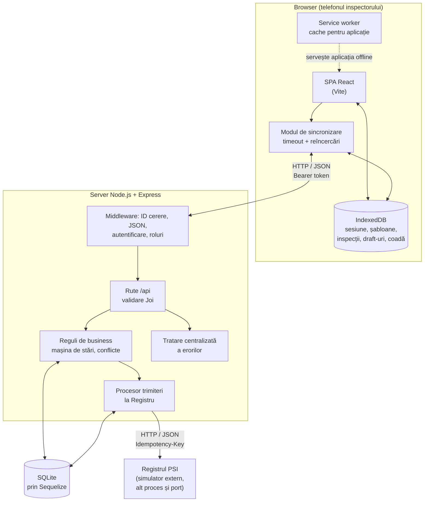
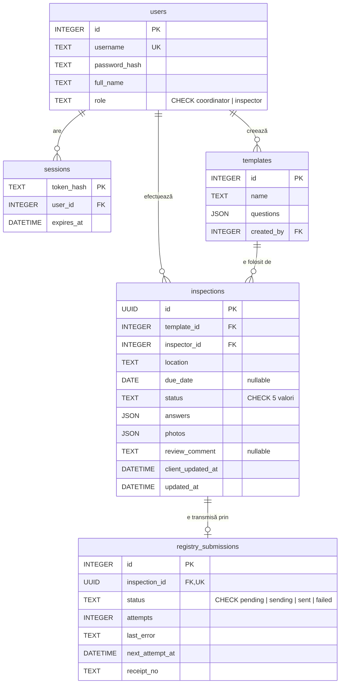
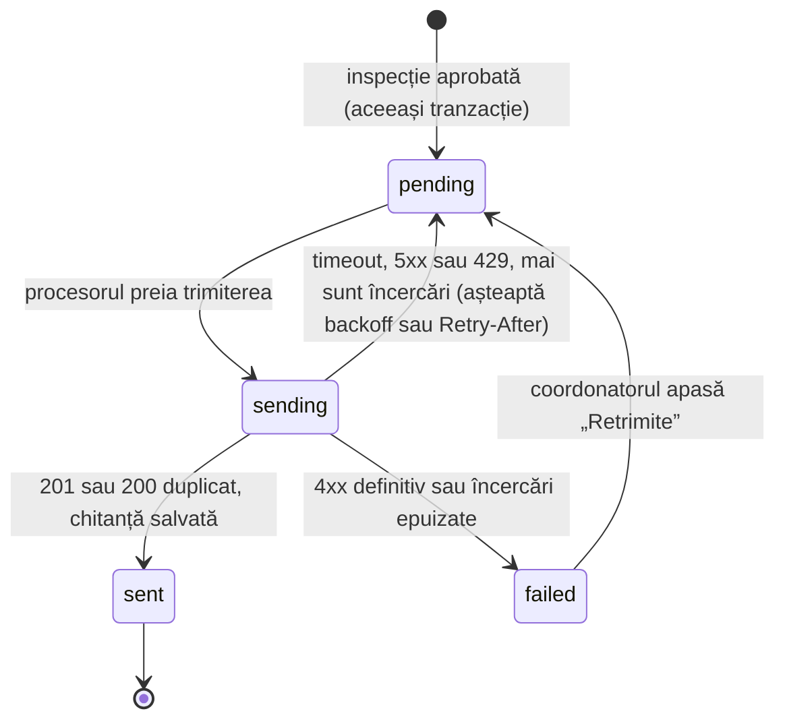

# Arhitectură — FireCheck

## Cuprins

1. [Vedere de ansamblu](#1-vedere-de-ansamblu)
2. [Tehnologii](#2-tehnologii)
3. [Structura proiectului](#3-structura-proiectului)
4. [Modelul de date](#4-modelul-de-date)
5. [API](#5-api)
6. [Sincronizarea offline (client)](#6-sincronizarea-offline-client)
7. [Integrarea cu Registrul PSI (server)](#7-integrarea-cu-registrul-psi-server)
8. [Securitate](#8-securitate)
9. [Observabilitate](#9-observabilitate)
10. [Rulare în producție](#10-rulare-în-producție)

---

## 1. Vedere de ansamblu



Două fluxuri de date sunt nesigure și sunt tratate de pachetele obligatorii:

- **browser → server** (pachetul **OFF**): rețeaua poate lipsi minute întregi; datele stau în
  IndexedDB și se trimit când rețeaua revine;
- **server → Registrul PSI** (pachetul **EXT**): serviciul extern poate fi lent, poate da erori,
  poate limita traficul sau poate răspunde duplicat; serverul reîncearcă controlat și păstrează
  starea fiecărei trimiteri în baza de date.

---

## 2. Tehnologii

Tehnologiile de bază sunt cele impuse de specificația generală. Bibliotecile suplimentare sunt
puține și justificate.

| Componentă | Tehnologie | Motiv |
|---|---|---|
| Limbaj | JavaScript, module ES, fără TypeScript | specificația generală |
| Server | Node.js LTS + Express 5 | specificația generală; Cursul 05 |
| Bază de date | SQLite prin Sequelize 6 | specificația generală; un singur fișier, fără server separat |
| Validare | Joi | Cursul 05 |
| Descriere API | OpenAPI 3.1 ([`openapi.json`](openapi.json)) | Cursul 05 |
| Interfață | React + Vite | specificația generală |
| Stocare locală | IndexedDB prin `idb-keyval` | API simplu `get`/`set`, capacitate mare, stochează și pozele (vezi ADR-001) |
| Offline | service worker generat cu `vite-plugin-pwa` | se integrează direct în build-ul Vite (vezi ADR-001) |
| Parole | `crypto.scrypt` (inclus în Node) | hash cu sare, fără dependențe native în plus |
| Teste unitate și integrare | `node:test` + `fetch` nativ | Cursul 05 (#38–39) |
| Coverage | `c8` | raportează exact statements și branches, cum cere specificația |
| Teste end-to-end și offline | Playwright | poate simula mod avion, reîncărcare, restart de browser și pierderea unui răspuns |
| Test de încărcare | Artillery | sugerat de specificație; suportă faze cu niveluri diferite de încărcare |
| Rulare în dezvoltare | `concurrently` | pornește serverul și Vite cu o singură comandă |

---

## 3. Structura proiectului

```
firecheck/
  README.md
  .env.example
  package.json, package-lock.json
  vite.config.js
  server/
    app.js                ← createApp(): middleware și rute, fără listen()
    index.js              ← pornește serverul și reia trimiterile la Registru
    config.js             ← configurația din variabile de mediu
    seed.js               ← date sintetice deterministe (npm run seed)
    db/                   ← conexiunea Sequelize, modelele și constrângerile
    middleware/           ← autentificare și roluri, validare Joi, tratarea erorilor
    security/             ← hash-ul parolelor, tokenurile de sesiune
    domain/               ← reguli pure: mașina de stări, regula de conflict, validări, DTO
    services/             ← operațiile pe inspecții (asignare, PUT idempotent, revizie)
    routes/               ← auth, templates, inspections, report
    registry/             ← clientul HTTP, backoff-ul și procesorul trimiterilor la Registru
  registry-sim/           ← simulatorul Registrului PSI (proces separat, npm run registry)
  scripts/ext-demo.js     ← demonstrația pachetului EXT (npm run demo:ext)
  client/
    index.html
    public/icon.svg
    src/
      main.jsx            ← pornește React și înregistrează service worker-ul
      App.jsx             ← rutele, separate pe rol
      lib/
        sync.js           ← motorul de sincronizare offline (fără React, testat în Node)
        http.js           ← cereri cu timeout și reîncercări limitate
        engine.js         ← IndexedDB (idb-keyval) și legătura motorului cu React
        photos.js         ← micșorarea pozelor în browser
      pages/              ← ecranele inspectorului și ale coordonatorului
      components/         ← antetul, stările de încărcare și eroare
  tests/
    unit/                 ← reguli pure
    api/                  ← integrare prin HTTP real
    ext/                  ← pachetul EXT, cu simulatorul pornit
    client/               ← modulul de sincronizare, contra serverului real
  e2e/                    ← teste Playwright (fluxul complet și pachetul OFF)
  load/                   ← testul de încărcare (Artillery, 3 niveluri)
  docs/
```

---

## 4. Modelul de date



Modelele sunt definite în [`server/db/models.js`](../server/db/models.js). Testul
[`tests/api/schema.test.js`](../tests/api/schema.test.js) verifică deja constrângerile de mai jos
direct pe baza de date.

### Constrângeri în baza de date

| Constrângere | Ce protejează |
|---|---|
| `inspections.id` cheie primară (UUID) | nicio inspecție duplicată, nici dacă validarea din cod ar fi ocolită (R1) |
| `CHECK (status IN (...))` pe `inspections`, `registry_submissions`, `users.role` | doar valori permise (R6) |
| `registry_submissions.inspection_id UNIQUE` | o singură trimitere, deci o singură chitanță pe inspecție (R10) |
| chei străine cu `ON DELETE RESTRICT` (`PRAGMA foreign_keys = ON`) | nicio inspecție fără șablon sau inspector existent |
| `users.username UNIQUE`, `NOT NULL` pe câmpurile obligatorii | integritatea datelor de bază |
| indexuri pe `inspections (inspector_id, updated_at)`, `(status)`, `(due_date)` | listările și filtrele nu citesc tot tabelul (lipsa lor a fost blocajul găsit la testul de încărcare, [`capacity.md`](capacity.md#6-rezultate-m3)) |

### Decizii

- **Răspunsurile și pozele sunt JSON în rândul inspecției.** O inspecție se citește și se scrie
  mereu întreagă, iar regula de conflict (R2) se aplică pe toată inspecția. Tabele separate pentru
  răspunsuri ar complica fiecare scriere fără beneficiu.
- **Asignarea nu are tabel separat:** e o inspecție cu status `assigned`.
- **Pozele sunt „demonstrative”** (cum spune enunțul): micșorate în browser (≤ 640 px, JPEG),
  maximum 3 × 200 KB, salvate în baza de date. Într-un sistem real ar sta într-un serviciu de
  fișiere.
- **Trimiterea la Registru are tabel propriu**, ca starea operației externe să fie persistentă,
  vizibilă și reluabilă după restartul serverului.
- **Schema** se creează din modele (`sequelize.sync()`), iar `npm run seed` o recreează de la
  zero. Proiectul nu are date de producție de păstrat între versiuni, deci migrările nu aduc
  beneficii (specificația le exclude oricum din coverage).
- **Scrierile sunt serializate.** SQLite acceptă o singură scriere la un moment dat, iar
  tranzacțiile Sequelize simultane eșuează („database is locked”). Toate scrierile trec prin
  `db.write()`, care le execută pe rând, fiecare în propria tranzacție. Pe disc se folosește
  modul WAL, ca citirile să nu fie blocate de scrieri. Limita: o singură instanță de server.
- **Asignările au `clientUpdatedAt` = 1970-01-01**, adică „încă nemodificată de inspector”. Astfel
  prima editare a inspectorului e mereu „mai nouă”, chiar dacă ceasul telefonului e în urma
  serverului. Regula e verificată de testul T-STATE-07.

---

## 5. API

Toate rutele sunt sub `/api`, folosesc JSON și, în afară de login și health, cer antetul
`Authorization: Bearer <token>`. Descrierea formală: [`openapi.json`](openapi.json).

| Metodă și cale | Rol | Descriere | Răspunsuri |
|---|---|---|---|
| `POST /api/auth/login` | public | `{ username, password }` → token valabil 7 zile | 200, 400, 401, 429 |
| `POST /api/auth/logout` | ambele | invalidează tokenul | 204, 401 |
| `GET /api/me` | ambele | utilizatorul curent | 200, 401 |
| `GET /api/users` | coordonator | lista inspectorilor (pentru asignare și filtre) | 200, 401, 403 |
| `GET /api/templates` | ambele | lista șabloanelor | 200, 401 |
| `POST /api/templates` | coordonator | `{ name, questions[] }` | 201, 400, 401, 403 |
| `GET /api/inspections` | ambele | listă cu filtrare, sortare, paginare (inspectorul vede doar ale lui) | 200, 400, 401 |
| `POST /api/inspections` | coordonator | asignare `{ templateId, inspectorId, location, dueDate }` | 201, 400, 401, 403 |
| `GET /api/inspections/{id}` | ambele | detalii, inclusiv poze și starea trimiterii la Registru | 200, 400, 401, 404 |
| `PUT /api/inspections/{id}` | inspector | creare sau actualizare idempotentă a unei inspecții proprii | 200, 201, 400, 401, 403, 404, 409, 413 |
| `POST /api/inspections/{id}/review` | coordonator | `{ decision: "approve" \| "return", comment }` | 200, 400, 401, 403, 404, 409 |
| `POST /api/inspections/{id}/registry/retry` | coordonator | repune în coadă o trimitere `failed` | 202, 401, 403, 404, 409 |
| `GET /api/report` | coordonator | raport central, filtre `from`, `to`, `inspectorId` | 200, 400, 401, 403 |
| `GET /api/health` | public | starea serverului și a bazei de date | 200, 500 |

### `PUT /api/inspections/{id}`: operația centrală pentru OFF

Corp:

```json
{
  "templateId": 1,
  "location": "Bloc A, parcare -2",
  "status": "in_progress",
  "answers": {
    "q1": { "value": "pass", "note": "" },
    "q2": { "value": "fail", "note": "Stingător expirat din 03/2026" }
  },
  "photos": ["data:image/jpeg;base64,/9j/4AAQ..."],
  "clientUpdatedAt": "2026-11-20T09:14:03.120Z"
}
```

Algoritmul serverului, în ordine, într-o singură tranzacție:

1. Validează corpul (R7) și marcajul de timp (R8) → 400 la eroare.
2. Caută inspecția după ID. Dacă există și aparține altui inspector → **404** (R4).
3. Dacă nu există: verifică șablonul, răspunsurile și tranziția (R6) și o creează → **201**,
   `applied: true`. Cererile simultane pentru același ID se execută pe rând (`db.write()`), deci a
   doua găsește inspecția deja creată și continuă cu pasul 4.
4. Dacă `templateId` diferă de cel salvat → 400 (R7).
5. Dacă `clientUpdatedAt` ≤ valoarea salvată → **200**, `applied: false`, fără nicio
   modificare (R1, R2). Asta acoperă cererile duplicate și cele vechi întârziate.
6. Dacă inspecția e `submitted` sau `approved` → **409** `INSPECTION_LOCKED`, cu starea de pe
   server (R3).
7. Verifică răspunsurile și tranziția, apoi actualizează → **200**, `applied: true`.

Răspunsul conține mereu inspecția așa cum e pe server, ca clientul să o poată salva local:

```json
{ "applied": true, "inspection": { "id": "…", "status": "in_progress", "…": "…" } }
```

### `POST /api/inspections/{id}/review`

Doar din `submitted`, altfel 409 `INVALID_TRANSITION`. La `approve`, statusul devine `approved`
și se creează o trimitere `pending` în aceeași tranzacție (R11), apoi procesorul o preia imediat.
La `return`, comentariul (5–500 caractere) e obligatoriu.

### Paginare

```json
{ "items": [ … ], "page": 1, "pageSize": 20, "total": 40, "totalPages": 2 }
```

### Formatul erorilor

```json
{ "error": { "code": "VALIDATION_ERROR", "message": "Date invalide", "details": [
  { "path": "answers.q9", "message": "Întrebarea nu există în șablon" }
] } }
```

| Cod | Status | Când |
|---|---|---|
| `VALIDATION_ERROR` | 400 | date invalide, JSON invalid, parametri de listare invalizi |
| `UNAUTHENTICATED` | 401 | token lipsă, invalid sau expirat; date de login greșite |
| `FORBIDDEN` | 403 | rolul nu permite operația |
| `NOT_FOUND` | 404 | resursa nu există sau nu aparține utilizatorului |
| `INSPECTION_LOCKED` | 409 | inspectorul modifică o inspecție în revizie sau aprobată |
| `INVALID_TRANSITION` | 409 | revizie pe o inspecție care nu e `submitted`; reîncercare pe o trimitere care nu e `failed` |
| `PAYLOAD_TOO_LARGE` | 413 | corp peste 1 MB |
| `RATE_LIMITED` | 429 | prea multe autentificări eșuate pentru același cont (R14) |
| `INTERNAL_ERROR` | 500 | orice eroare neprevăzută; fără detalii interne |

---

## 6. Sincronizarea offline (client)

Detaliile și alternativele: [`packages/OFF.md`](packages/OFF.md) și
[`adr/ADR-001-offline-indexeddb-sincronizare.md`](adr/ADR-001-offline-indexeddb-sincronizare.md).

**Ce se păstrează în IndexedDB:**

| Cheie | Conținut |
|---|---|
| `session` | tokenul și utilizatorul (permite pornirea offline) |
| `templates` | șabloanele, descărcate la ultima sincronizare |
| `inspections` | ultima copie confirmată de server a fiecărei inspecții proprii |
| `drafts` | copiile modificate local și neconfirmate |
| `outbox` | ID-urile inspecțiilor care așteaptă trimiterea |

**Algoritmul de sincronizare** (pornește la deschiderea aplicației, la evenimentul `online`,
după fiecare salvare făcută online și la apăsarea butonului „Sincronizează”):

1. Pentru fiecare ID din `outbox`: `PUT /api/inspections/{id}` cu draft-ul.
   - Timeout 5 s cu `AbortController`. Reîncercare pentru erori de rețea, timeout și 5xx,
     maximum 3 încercări, pauze de 500 ms și 1000 ms.
   - **2xx:** salvează inspecția primită, șterge draft-ul și ID-ul din coadă. Dacă
     `applied: false`, afișează „Înlocuită de o versiune mai nouă”.
   - **409:** preia starea serverului, șterge draft-ul, afișează conflictul.
   - **400:** păstrează draft-ul, marchează inspecția cu eroarea, nu reîncearcă.
   - **401:** oprește sincronizarea, păstrează coada și cere autentificarea din nou.
2. Descarcă inspecțiile proprii (`GET /api/inspections`, pagină cu pagină) și șabloanele.
   Inspecțiile care au draft local nu sunt suprascrise.

Doar o sincronizare rulează la un moment dat (un indicator în memorie), ca să nu existe două
trimiteri paralele ale aceleiași cozi din același tab.

**Detalii de implementare** (`client/src/lib/sync.js`):
- O modificare salvată cât rulează o sincronizare (sau un apel nou de sincronizare în timpul
  uneia) cere o rundă suplimentară, care pornește automat la final.
- Cât aplicația e deschisă și online, pornește o rundă nouă la fiecare 30 s și la revenirea în
  aplicație (tab vizibil). Acoperă semnalul slab (`navigator.onLine` e adevărat, dar serverul nu a
  răspuns, deci coada a rămas) și aduce modificările de pe alte dispozitive chiar dacă aici nu e
  nimic de trimis. Pentru 50 de inspectori înseamnă ~1,7 listări pe secundă, incluse în nivelul L1
  al testului de încărcare.
- **Ceasul:** la fiecare răspuns, clientul compară ora serverului (antetul `Date`) cu ceasul lui,
  la momentul în care au sosit **antetele**, nu după descărcarea corpului: o descărcare lentă nu
  trebuie confundată cu un ceas greșit. Se măsoară doar încercarea reușită: timpul încercărilor
  eșuate (timeout) și al pauzelor dintre ele nu e socotit. Un răspuns ale cărui antete au venit în
  peste o secundă e mai puțin precis (eroare de până la 500 ms + jumătate din drumul dus-întors), deci
  schimbă corecția doar dacă diferența depășește pragul plus această eroare: un ceas corect nu e mutat
  de un răspuns lent, dar un ceas greșit cu minute întregi e corectat și pe o rețea lentă.
  Corecția se schimbă doar când noua măsurătoare se depărtează cu peste 2 s de cea folosită acum
  (histerezis): antetul are rezoluție de o secundă, iar fără histerezis corecția ar sări între 0 și
  ~2,5 s la un ceas aflat lângă prag. Corecția se păstrează în IndexedDB (R8).
- **O modificare e mereu mai nouă decât varianta pe care se bazează:** marcajul unei editări e
  cel puțin cu 1 ms după draft-ul anterior și după ultima copie de pe server (pe care utilizatorul a
  văzut-o). Astfel, propriile editări nu se pot pierde din cauza ceasului; marcajele decid doar
  între modificări făcute în paralel, fără ca una să o fi văzut pe cealaltă.
- **Refuzuri (4xx):** dacă serverul respinge o variantă care între timp a fost înlocuită local,
  varianta nouă rămâne în coadă și pleacă în runda următoare. Altfel, draft-ul rămâne cu mesajul
  serverului și e numărat în antet ca nesincronizat.
- **Salvarea locală:** dacă scrierea în IndexedDB eșuează (de exemplu spațiu plin), starea din
  memorie revine, formularul afișează eroarea, iar salvările următoare continuă să încerce.
- **Un singur tab activ:** la pornire, aplicația cere un lacăt (Web Locks API). Un al doilea tab
  afișează un mesaj și pornește automat când primul se închide; altfel, două tab-uri și-ar
  suprascrie draft-urile.
- **Șabloanele** se descarcă la prima sincronizare, când apare un șablon necunoscut și cel mult o
  dată la 10 minute, deci o sincronizare periodică face, de regulă, o singură cerere.
- **Inspecție trimisă offline:** e afișată blocată imediat, chiar înainte să ajungă pe server.
- **Conflict în ordine inversă:** clientul ține minte marcajul ultimei lui modificări acceptate
  (`sentByMe`). Dacă la o descărcare ulterioară serverul are un marcaj mai nou, înseamnă că alt
  dispozitiv i-a înlocuit modificarea și se afișează un mesaj, oricare ar fi fost ordinea
  sincronizărilor.
- `applied: false` cu **același** `clientUpdatedAt` = propria cerere, deja primită de server
  (retransmisie) → fără mesaj. Cu **alt** marcaj = o modificare mai nouă de pe alt dispozitiv →
  mesajul „Pe server exista o variantă mai nouă…”.
- Un draft se șterge la confirmare doar dacă marcajul lui e cel trimis. O modificare făcută chiar
  în timpul trimiterii rămâne în coadă pentru următoarea rundă.
- La autentificarea unui alt utilizator pe același dispozitiv, datele locale ale celui anterior
  se șterg (R4). Delogarea șterge tot, cu confirmare dacă există modificări nesincronizate.
- Formularul salvează local la 400 ms după ultima modificare, iar la ieșirea din ecran salvează
  imediat. Prima salvare a unei inspecții noi îi fixează ID-ul (UUID).

**Service worker** (`vite.config.js`): generat de `vite-plugin-pwa` la `npm run build`. Pune în
cache HTML, CSS și JS și răspunde la orice navigare cu `index.html`, deci reîncărcarea merge
offline. Rutele `/api` nu sunt puse în cache. În `npm run dev`, service worker-ul nu e activ;
funcționarea offline se verifică pe build-ul de producție (`npm run build && npm start`).

---

## 7. Integrarea cu Registrul PSI (server)

Detaliile, contractul HTTP și alternativele: [`packages/EXT.md`](packages/EXT.md) și
[`adr/ADR-002-registru-extern-rezilient.md`](adr/ADR-002-registru-extern-rezilient.md).



- **Procesorul** rulează în procesul serverului. Pornește imediat după aprobare, iar la
  pornirea serverului reia trimiterile rămase `pending` sau `sending` (întrerupte de un restart).
- **Clientul HTTP** trimite `Idempotency-Key: <id inspecție>` și cheia de acces din
  `REGISTRY_API_KEY`, cu timeout de 3 s.
- **Reîncercări:** maximum 5 încercări, backoff 1 s, 2 s, 4 s, 8 s; la 429 se așteaptă
  `Retry-After` (secunde sau dată HTTP, plafonat la 10 minute, doar ca protecție față de valori
  absurde); un 429 fără `Retry-After` primește backoff-ul normal. Fără reîncercare la 400 și 401.
  După un restart, o trimitere rămâne `pending` cât așteaptă pauza programată. O excepție neprevăzută (în afara răspunsurilor clasificate) trece trimiterea în
  `failed`, cu mesajul erorii, ca să nu rămână blocată în `sending`.
- **Deduplicare:** chitanța se salvează o singură dată. Un răspuns duplicat al Registrului
  (`200`, `duplicate: true`, aceeași chitanță) e tratat ca succes.
- **Teste deterministe:** simulatorul primește un „scenariu” de răspunsuri (de exemplu
  `["timeout", "rate_limit", "ok"]`), iar în teste pauzele de backoff sunt scurtate prin
  configurare.

---

## 8. Securitate

| Subiect | Tratament |
|---|---|
| Parole | Hash `scrypt` cu sare aleatorie per utilizator; parolele nu se păstrează și nu se jurnalizează niciodată în clar. |
| Autentificare | Același mesaj și același timp de răspuns pentru cont inexistent și parolă greșită: pentru un cont inexistent se verifică un hash fals. După 10 eșecuri pentru același cont de la aceeași adresă, sau 50 de eșecuri de la aceeași adresă pe orice conturi, în 15 minute → 429 cu `Retry-After` (R14). Contoarele sunt în memorie (o singură instanță), cu cel mult 10.000 de intrări: cele expirate și cele mai vechi se șterg. |
| Token de sesiune | 32 de octeți aleatorii; pe server se păstrează doar hash-ul SHA-256, cu expirare după 7 zile. Logout-ul șterge sesiunea. |
| Unde stă tokenul în browser | În IndexedDB, trimis în antetul `Authorization`. Nu folosim cookie-uri, deci nu există risc de CSRF. Riscul de XSS e redus de React (escapează textul implicit; nu se folosește `dangerouslySetInnerHTML`) și de CSP (mai jos). |
| CORS | **Dezactivat.** În producție, Express livrează și aplicația React, deci totul e pe aceeași origine. În dezvoltare, Vite redirecționează `/api` către Express (proxy). Nu se trimite niciun antet `Access-Control-Allow-*`. |
| Autorizare | Pe fiecare rută (rol) și pe fiecare obiect (proprietarul inspecției). Obiectele altor inspectori întorc 404. |
| Validare | Joi pe fiecare corp și parametru; limită de 1 MB pentru corp. Pozele: tip declarat JPEG/PNG, **semnătura fișierului** verificată (primii octeți) și mărimea ≤ 200 KB. |
| Interogări | Prin Sequelize. În raport, valorile filtrelor sunt **parametri legați** (`bind`: trimise la SQLite separat de textul interogării). Căutarea în locație folosește `instr()`, nu `LIKE`, deci `%` și `_` din text nu sunt interpretate. Niciun SQL construit prin concatenarea datelor primite. |
| Erori | Răspuns 500 generic; detaliile (stack trace, SQL) doar în jurnalul serverului, cu ID-ul cererii. |
| Jurnale | Doar metoda, calea, statusul, durata și ID-ul cererii. Fără corpuri, tokenuri sau parole. |
| Secrete | `REGISTRY_API_KEY` și celelalte setări în `.env`, care e în `.gitignore`. `.env.example` conține doar o cheie de exemplu pentru simulatorul local. Fără cheie, serverul pornește cu un avertisment, iar trimiterile la Registru eșuează cu 401. |
| Antete | `X-Powered-By` dezactivat; `X-Content-Type-Options: nosniff`, `Referrer-Policy: no-referrer` și `Content-Security-Policy` pe toate răspunsurile: scripturi, stiluri și conexiuni doar de pe propria origine, poze ca `data:`, fără `unsafe-inline` / `unsafe-eval`, `frame-ancestors 'none'`. |
| Dependențe | `npm audit --omit=dev` (ce rulează în producție): 2 vulnerabilități moderate, în pachetul `uuid` folosit intern de Sequelize. Apar doar când se transmite un buffer extern funcțiilor `uuid` v3/v5/v6, ceea ce proiectul nu face. Restul raportului `npm audit` (13 moderate, 2 low) vine din uneltele de dezvoltare (Artillery, Workbox), care nu rulează în aplicație. Se reverifică la fiecare etapă. |

---

## 9. Observabilitate

- Fiecare cerere primește un ID (`X-Request-Id`), inclus în răspuns și în jurnal.
- Jurnalul se scrie la evenimentul `finish` al răspunsului, ca JSON pe o linie (Cursul 05, #37).
- Cu `METRICS=1`, serverul scrie la fiecare secundă procesorul și memoria folosite; testul de
  încărcare le folosește în raport.

---

## 10. Rulare în producție

```bash
npm ci
npm run build    # construiește aplicația React în client/dist
npm start        # Express servește API-ul și aplicația pe același port
```

Aplicația rulează local în mod producție. Găzduirea publică nu e necesară (specificația generală,
secțiunea 9).
