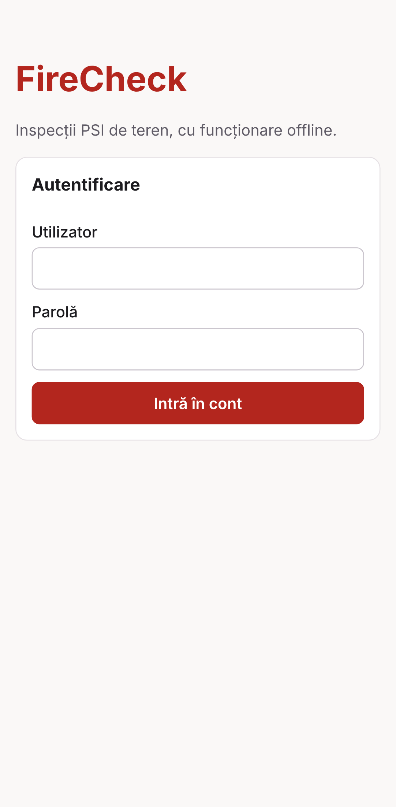
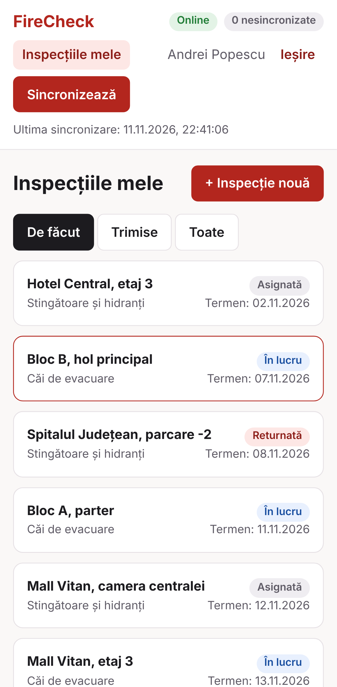
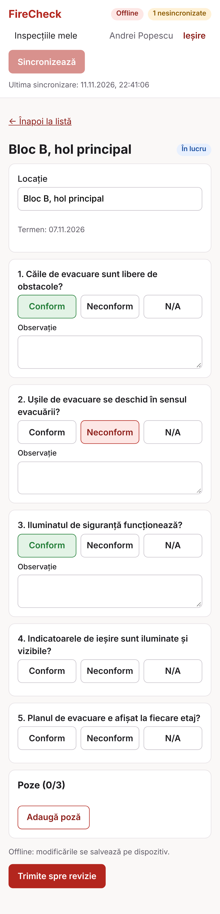
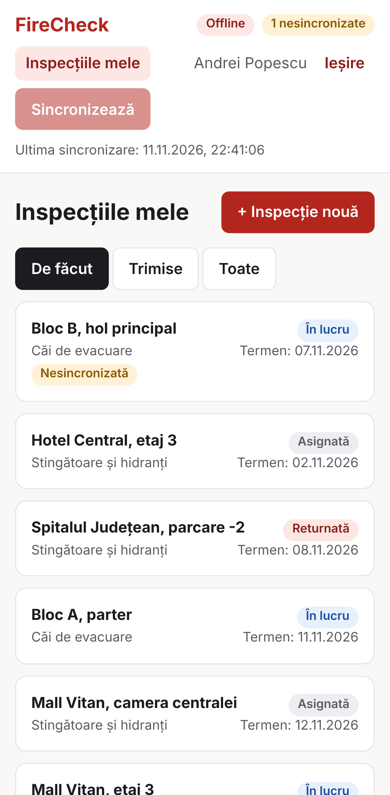

# Dovezi M3 — pachetul OFF

Rezultate reproductibile: se obțin din nou cu comenzile de mai jos.

| | |
|---|---|
| Sistem | Linux (mediu de dezvoltare), 2 nuclee, 8 GB RAM |
| Browser | Chromium (Playwright), emulare Pixel 7 |
| Node.js | 22.23 |
| Data | 11.11.2026 |

## 1. Testele în browser (Playwright, build de producție)

Comandă: `npm run test:e2e` (raport HTML: `npx playwright show-report`)

```
✓   1 [telefon] › e2e/flow.spec.js:4:1 › T-E2E-01 coordonatorul asignează → inspectorul completează și trimite → coordonatorul aprobă → chitanța Registrului
  ✓   2 [telefon] › e2e/flow.spec.js:44:1 › T-E2E-02 interfața nu are derulare orizontală la 390 px și la 1280 px
  ✓   3 [telefon] › e2e/off.spec.js:11:1 › T-OFF-01/03/08 mod avion → editare + creare → reîncărcare → revenire online → sincronizare automată
  ✓   4 [telefon] › e2e/off.spec.js:49:1 › T-OFF-02 restart de browser offline: datele rămân și se sincronizează după reconectare
  ✓   5 [telefon] › e2e/off.spec.js:80:1 › T-OFF-04 retransmisie: răspunsul primului PUT se pierde, clientul reîncearcă, pe server rămâne 1 inspecție
  ✓   6 [telefon] › e2e/off.spec.js:111:1 › T-OFF-05 conflict: două dispozitive editează offline aceeași inspecție; câștigă modificarea cea mai recentă
  ✓   7 [telefon] › e2e/off.spec.js:145:1 › T-OFF-06 conflict cu blocarea: A trimite spre revizie, B (offline, date vechi) editează → B preia starea serverului
  ✓   8 [telefon] › e2e/off.spec.js:176:1 › T-OFF-05b conflict în ordinea inversă: varianta veche ajunge prima, apoi cea nouă → dispozitivul vechi e anunțat
  ✓   9 [telefon] › e2e/off.spec.js:214:1 › T-OFF-09 serverul nu răspunde deși browserul e online: timeout, reîncercări, apoi trimitere automată la revenire
  ✓  10 [telefon] › e2e/off.spec.js:245:1 › T-OFF-10 inspecție trimisă spre revizie offline: rămâne blocată până ajunge pe server
  ✓  11 [telefon] › e2e/off.spec.js:269:1 › T-OFF-11 al doilea tab pe același dispozitiv așteaptă; devine activ când primul se închide

  11 passed
```

Rulat de mai multe ori la rând, fără eșecuri.

**Rularea cu 10 minute offline (T-OFF-07)** are propria dovadă, generată automat de
`npm run test:off-10min`, cu orele de start și final și ieșirea completă a testului:
[`off-10min.md`](off-10min.md).

## 2. Modulul de sincronizare (Node, contra serverului real)

Comandă: `node --test --test-reporter=spec tests/client/sync.test.js`

```
▶ cereri HTTP: timeout și reîncercări (R12)
  ✔ T-SYNC-01 eroare de rețea, apoi succes → reîncearcă și reușește
  ✔ T-SYNC-02 timeout la fiecare încercare → se oprește după 3 încercări
  ✔ 5xx se reîncearcă, 4xx nu
  ✔ 3 răspunsuri 5xx → NetworkError
  ✔ un corp care nu e JSON nu oprește clientul
✔ cereri HTTP: timeout și reîncercări (R12)
▶ motorul de sincronizare contra serverului real
  ✔ după login și sincronizare, inspectorul are local doar inspecțiile lui și șabloanele
  ✔ T-SYNC-09 offline: creare + editare, „restart” (motor nou, aceeași stocare), revenire online → pe server
  ✔ T-SYNC-03 răspuns pierdut + reîncercare → 1 rând, fără mesaj de conflict
  ✔ T-SYNC-08 conflict: două dispozitive, se păstrează modificarea cea mai recentă, cu mesaj
  ✔ T-SYNC-04 409: inspecția a fost trimisă de pe alt dispozitiv → se preia starea serverului, cu mesaj
  ✔ T-SYNC-05 400: draft-ul rămâne, cu mesajul serverului, și nu se mai retrimite
  ✔ T-SYNC-06 401 (sesiune expirată): coada rămâne intactă; după login, sincronizarea continuă
  ✔ T-SYNC-07 două sincronizări simultane → o singură rulare
  ✔ T-SYNC-10 o modificare făcută în timpul trimiterii e trimisă automat, fără alt apel de sincronizare
  ✔ T-SYNC-11 alt utilizator: refuzat cât există modificări nesincronizate; apoi nu vede datele celui anterior
  ✔ T-SYNC-12 conflict în ordinea inversă: varianta veche ajunge prima, cea nouă o înlocuiește → mesaj pe primul dispozitiv
  ✔ T-SYNC-13 ceas greșit: diferența față de server e corectată la marcajele de timp
  ✔ T-SYNC-14 ceas cu 2,2 s în urmă, 20 de editări consecutive: niciuna nu se pierde, niciun conflict fals
  ✔ T-SYNC-15 o editare făcută după ce ai văzut varianta altui dispozitiv o înlocuiește, chiar cu ceasul puțin în urmă
  ✔ T-SYNC-16 draft respins de server (400): e numărat ca nesalvat, iar alt cont nu se poate autentifica
  ✔ T-SYNC-17 o descărcare lentă nu e confundată cu un ceas greșit
  ✔ T-SYNC-18 refuz (400) pentru o variantă deja corectată local: varianta corectă pleacă totuși
  ✔ T-SYNC-19 dacă salvarea în stocare eșuează, modificarea nu apare ca salvată
  ✔ T-SYNC-20 o cerere reîncercată după timeout nu e confundată cu un ceas greșit
  ✔ T-SYNC-21 rețea lentă (antete în peste 1 s): un ceas greșit cu 10 minute e totuși corectat
  ✔ o diferență sub prag, măsurată pe o rețea lentă, nu mută un ceas corect
  ✔ sincronizarea periodică nu cere șabloanele de fiecare dată
  ✔ o diferență mică de ceas (sub 2 s) e ignorată
  ✔ login cu parolă greșită întoarce mesajul serverului
  ✔ două salvări în aceeași milisecundă: a doua e strict mai nouă
✔ motorul de sincronizare contra serverului real
ℹ tests 30
ℹ suites 2
ℹ pass 30
ℹ fail 0
ℹ cancelled 0
ℹ skipped 0
ℹ todo 0
```

## 3. Capturi de ecran

| | |
|---|---|
|  |  |
| Autentificare | Inspecțiile mele, online |
|  |  |
| Completare offline: „Offline” și „1 nesincronizate” în antet | Lista offline, cu inspecția nesincronizată |

Coordonator: [lista cu filtre](screens/05-coordonator-lista.png),
[aprobare și chitanța Registrului](screens/06-aprobare-chitanta.png), [raport](screens/07-raport.png).
