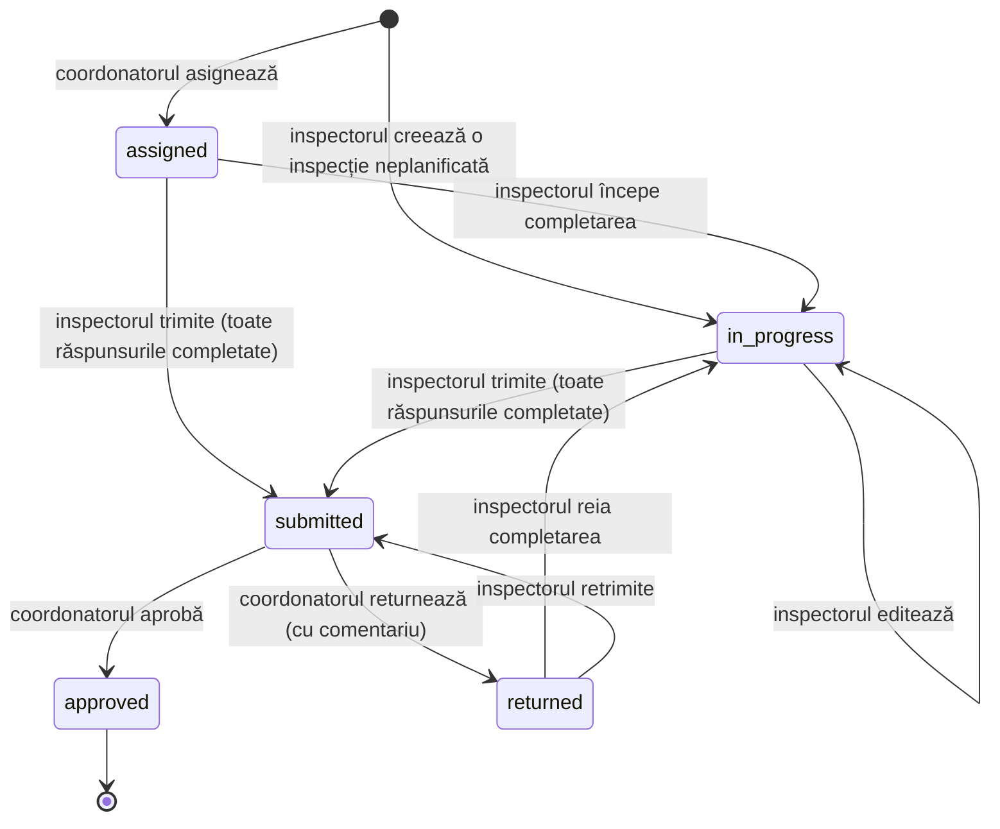

# Cerințe — FireCheck

**Temă:** Inspecții de teren offline · **Pachete obligatorii:** OFF + EXT
**Surse:** fișa temei, `00-general-specifications.md`, `01-architectural-challenges.md`

## Cuprins

1. [Context și obiectiv](#1-context-și-obiectiv)
2. [Actori și permisiuni](#2-actori-și-permisiuni)
3. [Glosar](#3-glosar)
4. [Fluxuri utilizator și criterii de acceptare](#4-fluxuri-utilizator-și-criterii-de-acceptare)
5. [Fluxul cu stări al inspecției](#5-fluxul-cu-stări-al-inspecției)
6. [Reguli de business și invariante](#6-reguli-de-business-și-invariante)
7. [Filtrare, sortare și paginare](#7-filtrare-sortare-și-paginare)
8. [Integrarea externă: Registrul PSI](#8-integrarea-externă-registrul-psi)
9. [Cerințe nefuncționale](#9-cerințe-nefuncționale)
10. [Trasabilitate față de enunț](#10-trasabilitate-față-de-enunț)
11. [În afara domeniului](#11-în-afara-domeniului)

---

## 1. Context și obiectiv

O firmă de servicii PSI (prevenire și stingere a incendiilor) trimite inspectori în clădiri ca să
verifice stingătoarele, hidranții și căile de evacuare. Inspecțiile au loc des în subsoluri,
parcări subterane sau camere tehnice, unde semnalul lipsește sau e instabil.

**FireCheck** este o aplicație web în care:

- **coordonatorul** definește checklist-uri (șabloane), asignează inspecții și le revizuiește;
- **inspectorul** completează checklist-ul pe telefon, **chiar și fără internet**, iar datele se
  sincronizează când rețeaua revine;
- fiecare inspecție aprobată este transmisă automat unui **serviciu extern, Registrul PSI**, care
  întoarce un număr de înregistrare (chitanță);
- coordonatorul vede un **raport central** cu toate inspecțiile.

Obiectivul tehnic: datele introduse offline nu se pierd (nici la reîncărcarea paginii, nici la
închiderea browserului), iar o rețea sau un serviciu extern nesigur (timeout-uri, erori, limitare
de trafic, răspunsuri duplicate) nu produce date duplicate sau stări incoerente.

---

## 2. Actori și permisiuni

| Actor | Rol | Descriere |
|---|---|---|
| **Coordonator** | privilegiat (`coordinator`) | Creează șabloane, asignează inspecții, le aprobă sau le returnează, vede toate inspecțiile și raportul central. Lucrează de la birou, online. |
| **Inspector** | obișnuit (`inspector`) | Vede și completează doar inspecțiile proprii, inclusiv offline. Poate crea pe loc o inspecție neplanificată. |
| **Registrul PSI** | sistem extern | Primește inspecțiile aprobate și întoarce o chitanță. În proiect e un simulator local (vezi secțiunea 8). |

### Matricea de permisiuni (verificată pe server la fiecare cerere)

| Operație | Inspector | Coordonator |
|---|:---:|:---:|
| Autentificare / delogare | ✅ | ✅ |
| Vizualizare șabloane | ✅ | ✅ |
| Creare șablon | ❌ 403 | ✅ |
| Asignare inspecție unui inspector | ❌ 403 | ✅ |
| Listare inspecții (cu filtre, sortare, paginare) | doar proprii | toate |
| Vizualizare detalii inspecție | doar proprii (altfel 404) | toate |
| Creare / editare inspecție (completare checklist) | doar proprii | ❌ 403 |
| Trimitere spre revizie | doar proprii | ❌ 403 |
| Aprobare / returnare | ❌ 403 | ✅ |
| Reîncercare manuală a trimiterii la Registru | ❌ 403 | ✅ |
| Raport central | ❌ 403 | ✅ |
| Lista inspectorilor | ❌ 403 | ✅ |

Coordonatorul **nu** modifică răspunsurile unei inspecții. Doar inspectorul căruia îi aparține o
poate completa. Coordonatorul schimbă doar statusul, prin revizie.

---

## 3. Glosar

| Termen | Definiție |
|---|---|
| **Șablon** | Listă ordonată de întrebări (de ex. „Stingătorul are sigiliul intact?”). Nu se modifică după creare. |
| **Inspecție** | Completarea unui șablon pentru o locație. Are un inspector, un status, răspunsuri și poze opționale. |
| **Asignare** | Inspecție creată de coordonator pentru un inspector, încă necompletată (status `assigned`). |
| **Inspecție neplanificată** | Inspecție creată de inspector direct pe teren, eventual offline. |
| **Răspuns** | Pentru fiecare întrebare: `pass` (conform), `fail` (neconform) sau `na` (nu se aplică), plus o observație opțională. |
| **Draft local** | Copia unei inspecții salvată în browser (IndexedDB), încă neconfirmată de server. |
| **Coadă de sincronizare (outbox)** | Lista locală a inspecțiilor modificate care așteaptă să fie trimise la server. |
| **`clientUpdatedAt`** | Momentul (ISO 8601) ultimei modificări făcute de inspector, înregistrat de browser. Folosit la conflicte. |
| **Trimitere la Registru** | Operația prin care serverul transmite o inspecție aprobată Registrului PSI. Are propria stare: `pending`, `sending`, `sent`, `failed`. |
| **Chitanță** | Numărul de înregistrare întors de Registrul PSI (de ex. `PSI-2026-000123`). |

---

## 4. Fluxuri utilizator și criterii de acceptare

Criteriile sunt scrise în forma *Dat fiind / Când / Atunci* și fiecare are cel puțin un test
automat asociat (vezi [`testing.md`](testing.md)).

### F1 — Asignare și completare online

**Actori:** Coordonator, Inspector

1. Coordonatorul alege un șablon, un inspector, locația și termenul limită.
2. Inspectorul vede asignarea în „Inspecțiile mele”.
3. Inspectorul răspunde la întrebări, adaugă observații și, opțional, poze.
4. Inspectorul apasă „Trimite spre revizie”.

**Criterii de acceptare:**
- **CA1.1** Dat fiind un coordonator autentificat, când creează o asignare validă, atunci
  inspecția apare cu status `assigned` doar la inspectorul ales.
- **CA1.2** Dat fiind un inspector, când modifică un răspuns, atunci modificarea e salvată local
  imediat și, dacă e online, ajunge pe server în cel mult câteva secunde.
- **CA1.3** Dat fiind o inspecție cu întrebări fără răspuns, când inspectorul încearcă să o trimită
  spre revizie, atunci acțiunea e refuzată atât în interfață, cât și de server (400).
- **CA1.4** Dat fiind o inspecție complet completată, când inspectorul o trimite, atunci statusul
  devine `submitted` și inspecția nu mai poate fi editată de el, nici înainte să ajungă pe server
  (trimisă offline).
- **CA1.5** Pe toată durata, interfața arată stări de încărcare și mesaje de eroare clare.

### F2 — Completare offline și sincronizare

**Actor:** Inspector

1. Inspectorul deschide aplicația cât are rețea (se descarcă inspecțiile și șabloanele lui).
2. Rețeaua dispare (subsol, mod avion).
3. Inspectorul completează o inspecție asignată și creează una neplanificată.
4. Pagina se reîncarcă sau browserul se închide și se redeschide.
5. Rețeaua revine și aplicația sincronizează.

**Criterii de acceptare:**
- **CA2.1** Dat fiind un inspector autentificat anterior, când deschide sau reîncarcă aplicația
  offline, atunci aplicația se încarcă și afișează inspecțiile și draft-urile lui.
- **CA2.2** Dat fiind modificări făcute offline, când pagina se reîncarcă sau browserul repornește,
  atunci toate modificările sunt încă prezente.
- **CA2.3** Dat fiind cel puțin 10 minute offline cu modificări, când rețeaua revine, atunci toate
  modificările ajung pe server fără acțiune manuală.
- **CA2.4** Dat fiind că aceeași modificare e transmisă de mai multe ori (răspuns pierdut,
  reîncercare), atunci pe server există o singură inspecție, cu starea corectă.
- **CA2.5** Dat fiind aceeași inspecție modificată pe două dispozitive, când ambele
  sincronizează, în orice ordine, atunci rămâne varianta cu modificarea cea mai recentă, iar
  dispozitivul a cărui variantă a fost înlocuită afișează un mesaj (imediat, dacă sincronizează
  al doilea; altfel la următoarea sincronizare, cel mult 30 s cât e deschis online).
- **CA2.6** Indicatorul din antet arată „Online” / „Offline” și numărul de inspecții
  nesincronizate (în coadă sau respinse de server și încă de corectat).

### F3 — Revizie și transmitere la Registrul PSI

**Actori:** Coordonator, Registrul PSI

1. Coordonatorul deschide o inspecție `submitted`.
2. Alege „Aprobă” sau „Returnează”, cu un comentariu obligatoriu la returnare.
3. La aprobare, serverul transmite automat inspecția Registrului PSI.
4. Coordonatorul vede starea transmiterii și chitanța.

**Criterii de acceptare:**
- **CA3.1** Dat fiind o inspecție `submitted`, când coordonatorul o returnează cu comentariu,
  atunci statusul devine `returned`, iar inspectorul o poate edita din nou și vede comentariul.
- **CA3.2** Dat fiind o inspecție `submitted`, când coordonatorul o aprobă, atunci statusul devine
  `approved`, inspecția devine definitivă, iar transmiterea la Registru începe automat.
- **CA3.3** Dat fiind că Registrul răspunde cu timeout, eroare sau limitare de trafic, atunci
  serverul reîncearcă de un număr limitat de ori, iar starea transmiterii e vizibilă
  (`pending` / `sending` / `sent` / `failed`) și coerentă.
- **CA3.4** Dat fiind orice combinație de reîncercări și răspunsuri duplicate, atunci inspecția
  are cel mult o chitanță, iar Registrul are o singură înregistrare pentru ea.
- **CA3.5** Dat fiind o transmitere `failed`, când coordonatorul apasă „Retrimite”, atunci
  transmiterea reîncepe.
- **CA3.6** O revizie pe o inspecție care nu e `submitted` e refuzată (409).

### F4 — Raport central și căutare

**Actor:** Coordonator

**Criterii de acceptare:**
- **CA4.1** Raportul arată totalul pe status, situația pe fiecare inspector, întrebările cu cele
  mai multe neconformități și starea transmiterilor la Registru.
- **CA4.2** Lista de inspecții se poate filtra (status, inspector, text în locație, termen),
  sorta și pagina (vezi secțiunea 7). Parametrii invalizi întorc 400.

### F5 — Gestionare șabloane

**Actor:** Coordonator

**Criterii de acceptare:**
- **CA5.1** Coordonatorul creează un șablon cu nume și 1–30 de întrebări.
- **CA5.2** Șabloanele nu pot fi modificate după creare, deci răspunsurile vechi rămân mereu în
  acord cu întrebările lor.

---

## 5. Fluxul cu stări al inspecției

| Din | În | Cine | Condiție | Altfel |
|---|---|---|---|---|
| — | `assigned` | coordonator | șablon și inspector existente | 400 |
| — | `in_progress` / `submitted` | inspector | inspecție nouă cu ID generat de client; `submitted` doar cu toate răspunsurile | 400 |
| `assigned`, `in_progress`, `returned` | `in_progress` | inspector | proprietarul inspecției | 404 dacă nu e a lui |
| `assigned`, `in_progress`, `returned` | `submitted` | inspector | toate întrebările au răspuns | 400 |
| `submitted` | `approved` | coordonator | — | 409 din orice altă stare |
| `submitted` | `returned` | coordonator | comentariu de 5–500 caractere | 400 fără comentariu, 409 din altă stare |
| `submitted`, `approved` | orice | inspector | **blocat**: inspecția e în revizie sau definitivă | 409 `INSPECTION_LOCKED` |

Regulile de tranziție sunt implementate într-un singur modul pe server (o mașină de stări
explicită), testat separat prin teste de unitate.

---

## 6. Reguli de business și invariante

Coloana „Unde” arată nivelul la care e protejată regula: **BD** = constrângere în baza de date,
**API** = verificare pe server, **UI** = doar ajutor în interfață (niciodată singura protecție).

| ID | Regulă | Unde | Cum |
|---|---|---|---|
| **R1** | **Retransmiterea aceleiași inspecții nu produce duplicate.** | BD + API | ID-ul (UUID) e generat de client, iar salvarea se face cu `PUT /api/inspections/{id}`, care creează sau actualizează după ID. Cheia primară împiedică două rânduri cu același ID. Dacă două cereri identice ajung simultan, a doua primește răspunsul idempotent, nu o eroare. |
| **R2** | **Politica de conflicte: ultima modificare câștigă (după `clientUpdatedAt`).** | API | O modificare se aplică doar dacă `clientUpdatedAt` e **strict mai mare** decât cel salvat. Altfel serverul nu schimbă nimic și întoarce 200 cu `applied: false` și starea curentă, pe care clientul o preia. La egalitate rămâne varianta existentă. Astfel, o cerere veche reîncercată târziu nu suprascrie una nouă, iar o cerere duplicată nu are efect. |
| **R3** | **Inspecțiile blocate nu pot fi modificate de inspector.** | API | Pe o inspecție `submitted` sau `approved`, un `PUT` cu o modificare nouă întoarce 409 `INSPECTION_LOCKED` și starea de pe server. Clientul preia starea serverului și afișează conflictul. Un duplicat al cererii care a trimis inspecția (același `clientUpdatedAt`) primește în continuare 200 `applied: false`, nu 409. |
| **R4** | **Inspecțiile altor utilizatori rămân private.** | API | Fiecare interogare a unui inspector filtrează după utilizatorul autentificat. Pentru inspecția altcuiva, serverul răspunde 404 (nu 403), ca să nu dezvăluie că există. Un `PUT` pe ID-ul altcuiva întoarce 404 și nu schimbă nimic. |
| **R5** | **Rolul obișnuit nu poate executa operațiile rolului privilegiat.** | API | Middleware de autorizare pe fiecare rută: fără token → 401, rol greșit → 403. |
| **R6** | **Tranzițiile de status respectă mașina de stări.** | BD + API | Statusul e una din cele 5 valori (constrângere `CHECK`), iar tranzițiile sunt verificate de modulul de stări (secțiunea 5). |
| **R7** | **Datele de intrare sunt validate pe server.** | API | Schemă Joi pe fiecare cerere: ID UUID, răspunsuri doar la întrebări din șablon, valori în {`pass`, `fail`, `na`}, observație ≤ 500 caractere, maximum 3 poze JPEG/PNG de ≤ 200 KB fiecare, corp ≤ 1 MB (altfel 413), `templateId` neschimbabil după creare. Eșec → 400 cu lista erorilor. |
| **R8** | **Ceasul dispozitivului nu decide singur conflictele.** | client + API | Clientul compară ceasul lui cu ora serverului (antetul `Date` al fiecărui răspuns) și, dacă diferența depășește 2 s, corectează marcajele de timp ale modificărilor (cu histerezis, ca să nu oscileze; se măsoară doar încercarea reușită, la sosirea antetelor, deci reîncercările și descărcările lente nu sunt confundate cu un ceas greșit; un răspuns ale cărui antete au venit în peste o secundă schimbă corecția doar dacă diferența depășește pragul plus eroarea posibilă a măsurătorii, de 500 ms + jumătate din drumul dus-întors). În plus, o modificare făcută pe baza unei variante e mereu mai nouă decât acea variantă, deci propriile editări nu se pot pierde din cauza ceasului. Pe server, un `clientUpdatedAt` cu peste 5 minute în viitor → 400 (plasă de siguranță pentru un dispozitiv care nu a fost niciodată online cu ceasul greșit). |
| **R9** | **Șabloanele sunt imutabile.** | API | Nu există rute de editare sau ștergere a șabloanelor. |
| **R10** | **O inspecție aprobată are cel mult o trimitere și cel mult o chitanță în Registru.** | BD + API + extern | `UNIQUE (inspection_id)` pe tabela trimiterilor. Fiecare apel la Registru poartă antetul `Idempotency-Key` = ID-ul inspecției, deci și Registrul o înregistrează o singură dată. |
| **R11** | **Aprobarea și crearea trimiterii sunt atomice.** | BD | Schimbarea statusului în `approved` și inserarea trimiterii `pending` se fac în aceeași tranzacție. Nu poate exista o inspecție aprobată fără trimitere sau invers. |
| **R12** | **Reîncercările sunt limitate.** | API + client | Către Registru: maximum 5 încercări, timeout 3 s, backoff exponențial, respectarea antetului `Retry-After` la 429 (secunde sau dată HTTP, plafonat la 10 minute; fără antet, backoff normal); erorile 4xx (în afară de 429) nu se reîncearcă; o eroare neprevăzută duce trimiterea în `failed`, nu o lasă blocată. Din browser către server: maximum 3 încercări pe rundă, timeout 5 s, doar erori de rețea, timeout-uri și 5xx (regula din Cursul 03); cât aplicația e deschisă și online, o rundă nouă la fiecare 30 s (trimite ce a rămas în coadă și aduce modificările de pe alte dispozitive) și la revenirea în aplicație. |
| **R13** | **Datele locale nu se pierd până la confirmarea serverului.** | client | O inspecție iese din coada locală după un răspuns 2xx sau 409 (caz în care starea serverului e preluată explicit) ori după un refuz definitiv (4xx) al variantei trimise, caz în care rămâne ca draft, cu mesajul serverului, și e numărată în continuare ca nesincronizată; o variantă nouă salvată între timp rămâne în coadă. Coada e în IndexedDB, deci rezistă la reîncărcare și restart. O modificare salvată în timpul unei sincronizări pleacă într-o rundă suplimentară. Alt cont nu se poate autentifica pe dispozitiv cât există modificări nesincronizate (inclusiv cele respinse de server); delogarea cere confirmare. Un singur tab al aplicației e activ pe dispozitiv, ca tab-urile să nu-și suprascrie datele. |
| **R14** | **Încercările de autentificare sunt limitate.** | API | După 10 parole greșite pentru același cont, de la aceeași adresă, sau 50 de eșecuri de la aceeași adresă pe orice conturi, în 15 minute → 429 cu `Retry-After`. Timpul de răspuns e același pentru conturi existente și inexistente. |

---

## 7. Filtrare, sortare și paginare

Colecția: **inspecțiile** (`GET /api/inspections`).

| Parametru | Valori | Implicit |
|---|---|---|
| `status` | unul din cele 5 statusuri | toate |
| `inspectorId` | ID numeric (doar coordonator; pentru inspector e ignorat, se folosește el însuși) | toți |
| `q` | subșir căutat în locație (2–100 caractere), literal: `%` și `_` sunt simple caractere; fără diferență între litere mari și mici la literele fără diacritice | — |
| `dueBefore` | dată `AAAA-LL-ZZ` | — |
| `sort` | `dueDate`, `updatedAt`, `location`, `status` | `updatedAt` |
| `order` | `asc`, `desc` | `desc` |
| `page` | ≥ 1 | 1 |
| `pageSize` | 1–100 | 20 |

Răspuns: `{ items, page, pageSize, total, totalPages }`. Un parametru necunoscut sau invalid
întoarce 400. Lista nu conține pozele (doar `photoCount`), ca să rămână mică.

---

## 8. Integrarea externă: Registrul PSI

Fiecare inspecție aprobată e transmisă unui registru extern. Pentru cost zero și teste
reproductibile, registrul e un **simulator local**: o mică aplicație Express separată, pe alt
port, care respectă un contract HTTP fix și poate produce la comandă: **timeout, erori 5xx,
limitare de trafic (429 cu `Retry-After`) și răspunsuri duplicate**.

Contractul complet, comportamentul la erori și scenariile de test sunt în
[`packages/EXT.md`](packages/EXT.md). Decizia arhitecturală e în
[`adr/ADR-002-registru-extern-rezilient.md`](adr/ADR-002-registru-extern-rezilient.md).

---

## 9. Cerințe nefuncționale

| Categorie | Cerință |
|---|---|
| Offline | Minimum 10 minute de lucru offline, cu cel puțin o reîncărcare a paginii înainte de revenirea online (fișa temei). |
| Volum | Minimum 30 de inspecții seed. Seed-ul implicit creează 40, iar pentru testul de încărcare 5.000. |
| Performanță | Ținte și niveluri de încărcare în [`capacity.md`](capacity.md). |
| Interfață | Responsivă (telefon ≥ 360 px, desktop), elemente apăsabile ≥ 44 px, etichete pentru toate câmpurile, stări de încărcare și eroare. |
| Securitate | Parole doar ca hash, token de sesiune păstrat pe server doar ca hash, validarea intrărilor, autorizare pe fiecare operație și pe fiecare obiect, fără date sensibile în răspunsuri sau jurnale. Detalii în [`architecture.md`](architecture.md#8-securitate). |
| Reproductibilitate | Seed determinist, teste automate, instrucțiuni complete în `README.md`, fără servicii plătite. |

---

## 10. Trasabilitate față de enunț

| Cerință din enunț | Unde e acoperită |
|---|---|
| Asignări, șabloane, răspunsuri, poze opționale, draft local, sincronizare, raport central | F1, F2, F4, F5 |
| Retransmiterea nu produce duplicate | R1, R10, CA2.4, CA3.4 |
| Conflicte rezolvate după politica explicită | R2, R3, CA2.5 |
| Inspecțiile altora rămân private | R4 |
| 30+ inspecții seed; 10 minute offline cu reîncărcare | secțiunea 9, CA2.1–CA2.3 |
| OFF: creare/editare offline, sincronizare după restart; mod avion, reîncărcare, revenire online, retransmisii duplicate, conflict | F2, [`packages/OFF.md`](packages/OFF.md) |
| EXT: serviciu extern sau simulator cu timeout, erori, rate limit, răspuns duplicat; retry limitat, stări coerente, efecte idempotente | F3, R10–R12, [`packages/EXT.md`](packages/EXT.md) |
| Două roluri cu permisiuni distincte, autorizare pe server | secțiunea 2, R5 |
| Model relațional cu constrângeri de integritate | [`architecture.md`](architecture.md#4-modelul-de-date) |
| Minimum trei fluxuri cu criterii de acceptare | F1–F5 |
| Flux cu mai multe stări și reguli explicite | secțiunea 5 |
| Validare pe server, erori coerente, stări de încărcare/eroare în UI | R7, CA1.5 |
| Filtrare, sortare, paginare | secțiunea 7 |
| Integrare cu un serviciu extern sau substitut cu contract | secțiunea 8 |
| Interfață responsivă | secțiunea 9 |
| Invariantă protejată la nivel de backend/BD | R1, R6, R10, R11 |
| Securitate de bază | R4, R5, R7, R14; [`architecture.md`](architecture.md#8-securitate) |

---

## 11. În afara domeniului

- înregistrarea utilizatorilor și resetarea parolei (conturile vin din seed);
- ștergerea inspecțiilor sau a șabloanelor, reasignarea unei inspecții;
- notificări push;
- găzduire publică (aplicația rulează local în mod producție; fără servicii plătite);
- extensia opțională: îmbinarea conflictelor pe câmp.
